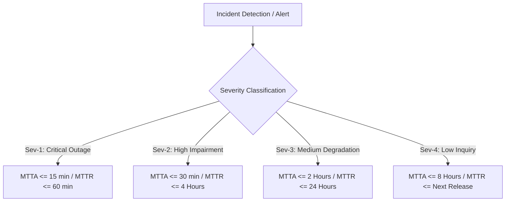

# SCHEDULE A: SERVICE LEVEL AGREEMENT & SERVICE LEVEL OBJECTIVES (SLA & SLO)

**Schedule Reference:** AB-NX-2026-SLA-001  
**Associated Agreement:** AB-NX-2026-MSA-001  
**Effective Date:** November 01, 2026  

This Service Level Agreement & Service Level Objectives Specification ("**SLA**") forms an integral part of the Master Cloud Services Agreement between Atlas Bank T.A.Ş. ("**Bank**") and NexaTech Solutions Inc. ("**Vendor**") governing the operational availability, system performance, incident management, and financial penalties for the FinGuard AI SaaS Platform.

---

## 1. CONCEPTUAL ARCHITECTURE: SLI, SLO, AND SLA

* **Service Level Indicator (SLI):** A quantifiable empirical metric measured over time representing system health (e.g., HTTP error rate, p99 response time).
* **Service Level Objective (SLO):** The internal engineering target set to maintain platform reliability before customer impact occurs (e.g., 99.99% monthly API success rate).
* **Service Level Agreement (SLA):** The legally and commercially binding contractual commitment made to the Bank, breach of which triggers monetary Service Credits and potential default remedies (e.g., $\ge$ 99.95% monthly uptime).

---

## 2. AVAILABILITY COMMITMENT (UPTIME SLA)

### 2.1. Minimum Monthly Availability
Vendor guarantees that the Production instance and mission-critical API endpoints of the FinGuard AI Platform shall maintain an aggregate Monthly Uptime Percentage of **at least 99.95%**.

### 2.2. Uptime Calculation Methodology
Monthly Uptime Percentage is calculated using the following industry-standard formula:

$$\text{Monthly Uptime (\%)} = \left( \frac{\text{Total Monthly Minutes} - \text{Excluded Minutes} - \text{Unscheduled Downtime Minutes}}{\text{Total Monthly Minutes} - \text{Excluded Minutes}} \right) \times 100$$

* *Total Monthly Minutes:* The total number of calendar minutes in the billing month (e.g., 43,200 minutes for a 30-day month).
* *Excluded Minutes:* Authorized Planned Maintenance windows and confirmed Bank-side network outages.
* *Unscheduled Downtime Minutes:* Periods where core APIs return HTTP 5xx responses, fail to respond within 3,000 ms, or are completely unreachable.

### 2.3. Planned Maintenance Windows
1. Scheduled maintenance is restricted exclusively to Sundays between **02:00 and 05:00 (UTC+3)**.
2. Advance written notice of at least **seven (7) calendar days** must be provided to the Bank's Network Operations Center (NOC).
3. Except for critical emergency security patches, cumulative planned downtime shall not exceed **180 minutes per calendar month**.

---

## 3. TECHNICAL PERFORMANCE TARGETS (SLO / SLI MATRIX)

The Platform must satisfy the operational thresholds and Error Budget criteria below:

| Performance Metric | Service Level Indicator (SLI) | Internal Engineering Target (SLO) | Contractual Commitment (SLA) | Evaluation Window |
| :--- | :--- | :--- | :--- | :--- |
| **System Availability** | Proportion of successful (2xx/3xx/4xx) HTTP calls | **99.99%** Uptime | **99.95%** Uptime | Monthly Cumulative |
| **API Latency (p95)** | Bank API Gateway to FinGuard roundtrip | $\le$ 60 ms | $\le$ 100 ms | 5-Minute Sliding Windows |
| **API Latency (p99)** | Model inference and queue execution time | $\le$ 120 ms | $\le$ 200 ms | 5-Minute Sliding Windows |
| **Error Rate (5xx)** | Platform-generated HTTP 500, 502, 503 responses | $\le$ 0.01% | $\le$ 0.05% | Total Monthly Requests |
| **Throughput Capacity** | Peak concurrent request processing rate | 8,000 TPS | 5,000 TPS Guaranteed | Peak Burst Load |
| **Data Freshness** | Feature Store sync latency from Core Banking | $\le$ 500 ms | $\le$ 2,000 ms | Continuous |

### 3.4. Error Budget & Deployment Freeze Policy
Under the 99.95% monthly commitment, the maximum allowable unscheduled downtime is **21.6 minutes per month**. If **75% of the monthly error budget is depleted** at any point during a billing cycle:
* Vendor shall enforce an immediate freeze on non-essential feature releases.
* 100% of engineering bandwidth shall be reallocated to reliability, bug fixes, and architectural hardening.

---

## 4. INCIDENT MANAGEMENT, RESPONSE, AND RESOLUTION

Incidents are classified into four severity tiers based on business impact. Measurement timers start immediately upon Bank ticket submission or automated monitoring alerting.

### 4.1. Incident Classification Matrix

| Severity Tier | Business Impact & Criteria | Support Coverage | Target Response (MTTA) | Target Resolution (MTTR) | RCA Obligation |
| :--- | :--- | :--- | :--- | :--- | :--- |
| **Severity 1 (Critical)** | Complete production outage; real-time fraud scoring is down; payment transactions or FAST transfers are blocked. | 24/7/365 Continuous | **$\le$ 15 Minutes** | **$\le$ 1 Hour** (Restoration or Failover) | Formal RCA within 24 Hours |
| **Severity 2 (High)** | Major core functionality impaired; system redundancy lost; p99 latency exceeds 500ms; batch reporting queue failed. | 24/7/365 Continuous | **$\le$ 30 Minutes** | **$\le$ 4 Hours** | Formal RCA within 48 Hours |
| **Severity 3 (Medium)** | Non-critical feature malfunction; workaround is available; core transaction flow operates normally. | Business Hours (08:00-18:00) | **$\le$ 2 Hours** | **$\le$ 24 Hours** | Upon written request |
| **Severity 4 (Low)** | Cosmetic UI bugs, minor reporting discrepancies, or documentation feedback. | Business Hours | **$\le$ 8 Hours** | Next scheduled sprint cycle | N/A |

* **MTTA (Mean Time to Acknowledge):** Time elapsed until a senior technical engineer acknowledges the ticket and begins diagnostic engagement.
* **MTTR (Mean Time to Resolve/Restore):** Time elapsed until service is restored to full operation or an approved workaround is deployed.

---

## 5. SERVICE CREDIT AND PENALTY SCHEME

Failure to achieve the contractual Monthly Uptime Percentage entitles the Bank to the following **Service Credits**, deducted directly from the subsequent monthly invoice:

| Monthly Uptime Percentage Achieved | Service Credit Deducted from Monthly Fee | Bank's Additional Legal Rights |
| :--- | :--- | :--- |
| **$\ge$ 99.95%** | 0% (Full Service Delivered) | None |
| **99.90% — 99.94%** | **15%** of monthly subscription fee | Mandatory Corrective Action Plan (CAP) |
| **99.50% — 99.89%** | **30%** of monthly subscription fee | Executive-level escalation conference |
| **99.00% — 99.49%** | **50%** of monthly subscription fee | Right to commission third-party technical audit |
| **$<$ 99.00%** | **100% (Full Monthly Fee Forfeiture)** | **Immediate Right to Terminate for Cause with Damages** |

### 5.2. Severity-1 Extended Outage Surcharge
Independent of monthly uptime percentage, if any single Severity-1 incident exceeds an MTTR of **two (2) hours**, Vendor shall pay an additional penalty of **5% of the monthly fee per subsequent hour of downtime**, capped at a maximum of 50% of the monthly fee.

---

## 6. TELEMETRY, TRANSPARENCY, AND REPORTING

1. **Real-Time Telemetry Dashboard:** Vendor shall grant the Bank's SOC/NOC team continuous, read-only access to a dedicated monitoring dashboard (Grafana / Datadog) displaying real-time availability, latency histograms, error rates, and resource utilization.
2. **Monthly Service Report:** On the first business day of each calendar month, Vendor shall provide an executive signed report detailing uptime percentages, all incident logs, MTTA/MTTR compliance, and applied service credit calculations.
3. **Root Cause Analysis (RCA):** All Sev-1 and Sev-2 incidents require a formal Root Cause Analysis document adhering to the "5-Why" methodology, incorporating a complete incident chronology, technical trigger, systemic root causes, and permanent preventive actions.

---

| **ATLAS BANK T.A.Ş.** | **NEXATECH SOLUTIONS INC.** |
| :--- | :--- |
| **Signature:** ___________________________ | **Signature:** ___________________________ |
| **Name:** Mehmet Yılmaz / CIO | **Name:** Caner Özkan / CEO |
| **Date:** November 01, 2026 | **Date:** November 01, 2026 |
