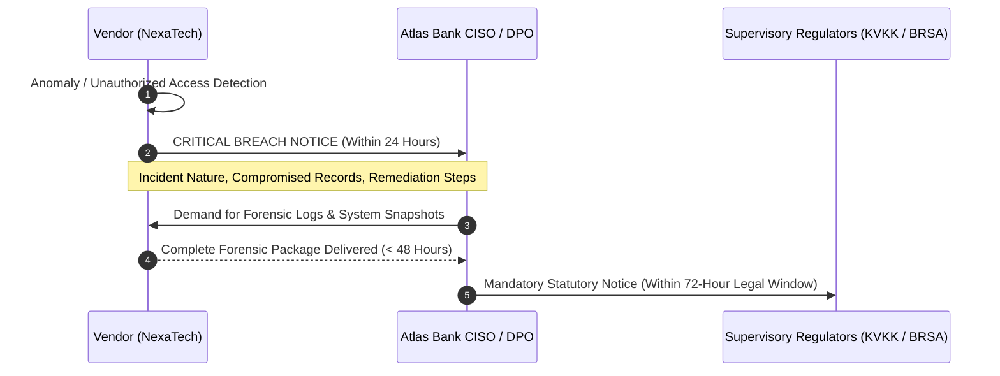

# SCHEDULE C: DATA PROCESSING AGREEMENT & BANKING SECRECY ADDENDUM (DPA)

**Schedule Reference:** AB-NX-2026-DPA-001  
**Associated Agreement:** AB-NX-2026-MSA-001  
**Effective Date:** November 01, 2026  

This Data Processing Agreement and Banking Secrecy Addendum ("**DPA**") is entered into by and between Atlas Bank T.A.Ş. ("**Bank**" or "**Data Controller**") and NexaTech Solutions Inc. ("**Vendor**" or "**Data Processor**") to govern the processing of personal data, financial transaction records, and banking secrets in connection with the Master Services Agreement.

---

## 1. REGULATORY FRAMEWORK AND DESIGNATION OF ROLES

1.1. **Parties' Roles:** The Bank acts as the **Data Controller** (Veri Sorumlusu), and Vendor acts exclusively as the **Data Processor** (Veri İşleyen) performing data processing tasks solely on behalf of and pursuant to the documented instructions of the Bank.  
1.2. **Governing Laws:** Processing activities under this DPA shall comply strictly with Turkish Law on the Protection of Personal Data No. 6698 ("**KVKK**"), Article 73 of Turkish Banking Law No. 5411 ("**Banking Secrecy**"), the European Union General Data Protection Regulation ("**GDPR**"), and relevant secondary regulations issued by the Banking Regulation and Supervision Agency (BRSA).

---

## 2. BANKING SECRECY AND SOVEREIGN DATA LOCALIZATION

2.1. **Perpetual Duty of Confidentiality:** Vendor acknowledges that all customer profiles, financial transactions, credit evaluations, and account balances ingested by the Platform constitute **Banking and Customer Secrets** under Article 73 of Law No. 5411. Vendor and its personnel shall hold such data in strict confidence perpetually, surviving the expiration or termination of this Agreement indefinitely.  
2.2. **Strict Sovereign Data Localization (Data Residency):**  
a) All Bank Data, transaction streams, server logs, operational caches, and disaster recovery replicas must reside and be processed **exclusively within the physical borders of the Republic of Türkiye**.  
b) Under no circumstances shall Vendor transmit, replicate, or make accessible any Bank Data to public cloud facilities or support personnel situated outside of Türkiye without prior written consent of the Bank and formal clearance from the BRSA.

---

## 3. DATA PROCESSING PRINCIPLES AND MODEL GOVERNANCE

3.1. **Strict Adherence to Instructions:** Vendor shall process Bank Data solely to the extent necessary to deliver the FinGuard AI SaaS services and in strict accordance with the Bank's written directives.  
3.2. **Data Minimization and Masking:**  
* Primary Account Numbers (PAN), CVVs, and sensitive payment instrument data must never be stored in plaintext and must adhere to PCI-DSS tokenization protocols.  
* Personally Identifiable Information (PII) including National Identity Numbers (TCKN) must be obfuscated using salted cryptographic hashes (SHA-256) or asymmetric field-level encryption.  
3.3. **AI Training Restrictions:** Vendor is strictly prohibited from utilizing Bank Data, whether anonymized, synthetic, or aggregated, to train, refine, or validate any commercial foundation model or third-party service. All model weights and artifacts produced with Bank Data belong exclusively to the Bank.

---

## 4. SUB-PROCESSORS

4.1. **Prior Written Approval:** Vendor shall not engage any sub-processor without obtaining prior written authorization from the Bank's Data Protection Officer (DPO) and Chief Compliance Officer.  
4.2. **Equivalent Contractual Safeguards:** Any authorized sub-processor must enter into a written agreement containing obligations no less stringent than those set forth in this DPA. Vendor remains fully, jointly, and severally liable to the Bank for all acts and omissions of its sub-processors.

---

## 5. DATA BREACH NOTIFICATION AND FORENSIC INVESTIGATION

5.1. **Notification SLA:** In the event of a confirmed or reasonably suspected personal data breach, security incident, or unauthorized access, Vendor shall formally notify the Bank's CISO and DPO in writing **within twenty-four (24) hours** of initial detection.  
5.2. **Notice Details:** The breach notification must contain: (a) a description of the incident, (b) categories and approximate number of data subjects impacted, (c) likely consequences, and (d) mitigation measures implemented or planned.  
5.3. **Forensic Audit:** Vendor shall preserve all relevant evidence and grant the Bank's appointed forensic specialists immediate access to inspect logs, memory dumps, and server images.

---

## 6. DATA SUBJECT RIGHTS ASSISTANCE

Vendor shall provide technical assistance to enable the Bank to respond to data subject inquiries (access, rectification, erasure, restriction of processing) under KVKK Article 11 and GDPR Chapter III within **three (3) business days** of receiving a written request.

---

## 7. DATA RETURN AND SANITIZATION PROTOCOL

7.1. **Secure Return:** Upon termination or expiration of the MSA, Vendor shall export all Bank Data, audit trails, and configuration models to the Bank in an agreed open schema (e.g., Apache Parquet, SQL dump) within **fifteen (15) calendar days**.  
7.2. **Permanent Destruction:** Following verified receipt by the Bank, Vendor shall permanently purge all remaining copies across active, backup, and archival storage in strict compliance with **NIST SP 800-88 Rev. 1 (Guidelines for Media Sanitization)** standards.  
7.3. **Certificate of Sanitization:** Vendor's Chief Information Security Officer shall execute and deliver a formal "Certificate of Destruction" to the Bank within seven (7) days of sanitization completion.

---

## 8. LIABILITY AND REGULATORY INDEMNITY

Vendor shall defend, indemnify, and hold harmless the Bank from and against any administrative fines, regulatory sanctions, civil damages, and legal expenses imposed on or incurred by the Bank as a result of Vendor's violation of this DPA, KVKK, GDPR, or Banking Secrecy obligations. **No contractual limitation of liability shall apply to breaches of this Section 8.**

---

| **ATLAS BANK T.A.Ş.** (Data Controller) | **NEXATECH SOLUTIONS INC.** (Data Processor) |
| :--- | :--- |
| **Signature:** ___________________________ | **Signature:** ___________________________ |
| **Name:** Zeynep Kaya, Esq. / CCO & DPO | **Name:** Murat Erdem, Esq. / Legal Counsel |
| **Date:** November 01, 2026 | **Date:** November 01, 2026 |
