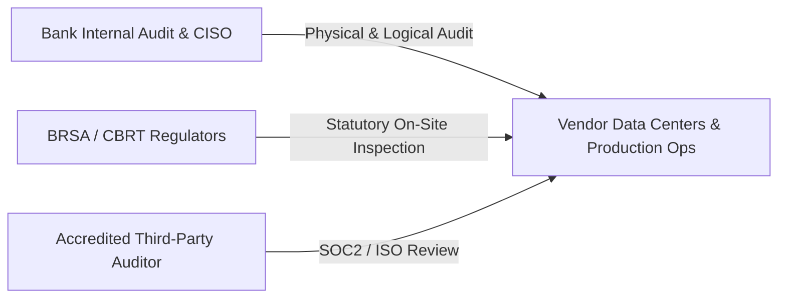

# SCHEDULE D: INFORMATION SECURITY AND CYBER RESILIENCE SPECIFICATION

**Schedule Reference:** AB-NX-2026-SEC-001  
**Associated Agreement:** AB-NX-2026-MSA-001  
**Effective Date:** November 01, 2026  

This Information Security and Cyber Resilience Specification ("**Specification**") establishes the mandatory technical, operational, and organizational security standards that NexaTech Solutions Inc. ("**Vendor**") must maintain to safeguard the information assets, data integrity, and business systems of Atlas Bank T.A.Ş. ("**Bank**") in relation to the FinGuard AI Platform.

---

## 1. MANDATORY CERTIFICATIONS AND COMPLIANCE BASELINES

Vendor shall maintain active accreditation throughout the term and furnish annual third-party validation reports for the following standards:
1. **ISO/IEC 27001:2022** (Information Security Management Systems)
2. **ISO/IEC 27017 & ISO/IEC 27018** (Cloud Security and Protection of PII in Public Clouds)
3. **SOC 2 Type II Report** (Covering the Security, Availability, and Confidentiality Trust Services Criteria, issued by an accredited independent CPA firm)
4. **PCI-DSS v4.0 Level 1 Service Provider** (Attestation of Compliance - AoC)
5. **BRSA IT Outsourcing Guidelines & EU Digital Operational Resilience Act (DORA)** alignment

---

## 2. IDENTITY AND PRIVILEGED ACCESS MANAGEMENT (IAM / PAM)

2.1. **Zero Trust Architecture:** Platform operations must implement Zero Trust principles. Network boundary placement shall not confer implicit trust to any entity, service, or user.  
2.2. **Multi-Factor Authentication (MFA):** Access to management consoles, Kubernetes clusters, and production environments requires hardware security keys (FIDO2 / WebAuthn) or time-based one-time password (TOTP) authenticators. SMS verification is strictly forbidden.  
2.3. **Zero Standing Privileges (ZSP) & Production Isolation:**  
* Vendor staff shall have no standing access to production environments containing unmasked Bank Data.  
* Emergency operational interventions require a **"Four-Eyes (Two-Person) Approval"** workflow and must be initiated through a privileged access management (PAM) bastion host utilizing time-limited (maximum 2 hours) ephemeral credentials.  
* All privileged sessions must be cryptographically recorded, with keystrokes and screen recordings indexed and accessible to the Bank.

---

## 3. SECURE SDLC AND VULNERABILITY REMEDIATION SLAs

3.1. **Automated CI/CD DevSecOps Controls:**  
Every source code build deployed to staging or production environments must undergo automated security scanning:
* **Static Application Security Testing (SAST):** Scans for OWASP Top 10 and CWE-25 vulnerabilities.
* **Software Composition Analysis (SCA):** Generates and verifies a Software Bill of Materials (SBOM) against known CVE databases.
* **Dynamic Application Security Testing (DAST):** Automated vulnerability probing against API endpoints.

3.2. **Vulnerability Remediation Timelines:**

| Severity Classification | CVSS v3.1 Base Score | Maximum Fix / Patch Timeline | Temporary Compensating Control |
| :--- | :--- | :--- | :--- |
| **Critical** | 9.0 — 10.0 | **$\le$ 48 Hours** | $\le$ 12 Hours (e.g., WAF virtual patch) |
| **High** | 7.0 — 8.9 | **$\le$ 7 Calendar Days** | $\le$ 24 Hours |
| **Medium** | 4.0 — 6.9 | **$\le$ 30 Calendar Days** | Included in next release |
| **Low** | 0.1 — 3.9 | **$\le$ 90 Calendar Days** | Regular release cycle |

---

## 4. PENETRATION TESTING AND THREAT DEFENSE

4.1. **Vendor Penetration Testing:** Vendor shall engage an independent, CREST-accredited or TSE A-Level certified cybersecurity firm at least **twice per calendar year** to conduct a comprehensive Grey-Box penetration test across the Platform infrastructure and APIs. Vendor shall deliver the executive summary and remediation verification report to the Bank.  
4.2. **Bank Right to Pentest:** The Bank reserves the right, upon five (5) business days' prior written notice, to conduct its own penetration tests, vulnerability scans, and red-teaming exercises against the Platform via internal security teams or appointed third-party ethical hackers.  
4.3. **DDoS Protection:** Vendor must deploy an enterprise cloud mitigation shield capable of absorbing and scrubbing volumetric Distributed Denial of Service (DDoS) attacks of at least 100 Gbps without degradation of Bank services.

---

## 5. IMMUTABLE SECURITY LOGGING AND SIEM INTEGRATION

5.1. **Comprehensive Event Logging:** All authentication events, role escalations, administrative configuration changes, API calls, and data access anomalies must be recorded with nanosecond-accurate NTP timestamps.  
5.2. **WORM Storage Retention:** Audit logs must be stored in Write-Once-Read-Many (WORM) cloud object storage, secured with cryptographic hashing (SHA-256), and retained for a minimum of **ten (10) years** to satisfy banking audit regulations.  
5.3. **Real-Time SIEM Feed:** Vendor shall stream relevant operational security and audit events to the Bank's centralized SIEM/SOAR system via secure Syslog (TLS RFC 5424) or authenticated Kafka topics.

---

## 6. REGULATORY AUDIT RIGHTS AND PHYSICAL INSPECTION

6.1. **Statutory Inspection Rights:** Under Turkish Banking Law No. 5411 and regulatory standards, officials from the BRSA, Central Bank, and the Bank's authorized audit representatives have the unfettered right to physically and logically inspect Vendor's data centers, production facilities, source code repositories, and operational logs.  
6.2. **Immediate Access Guarantee:** Vendor shall provide unhindered access, workspace, and technical support to designated regulatory inspectors without requiring undue legal delays.

---

| **ATLAS BANK T.A.Ş.** | **NEXATECH SOLUTIONS INC.** |
| :--- | :--- |
| **Signature:** ___________________________ | **Signature:** ___________________________ |
| **Name:** Hakan Şen / CISO | **Name:** Serdar Aydın / Head of Security |
| **Date:** November 01, 2026 | **Date:** November 01, 2026 |
