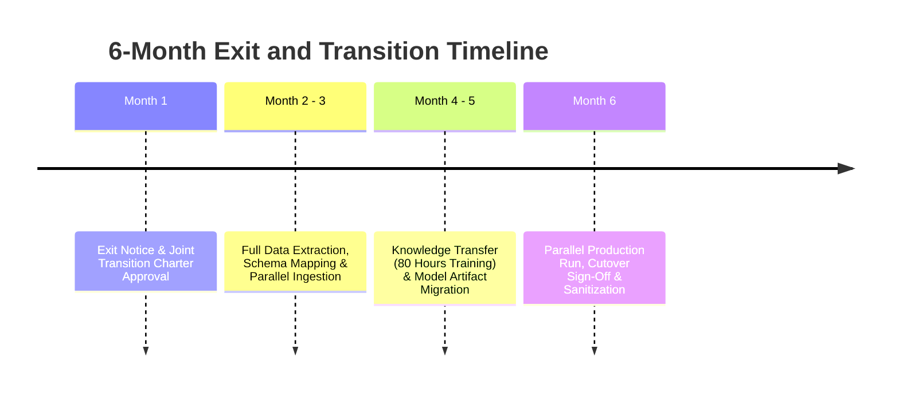

# SCHEDULE E: BUSINESS CONTINUITY, SOFTWARE ESCROW, AND EXIT STRATEGY

**Schedule Reference:** AB-NX-2026-BCP-001  
**Associated Agreement:** AB-NX-2026-MSA-001  
**Effective Date:** November 01, 2026  

This Business Continuity, Software Escrow, and Exit Strategy Specification ("**Schedule E**") is executed by and between Atlas Bank T.A.Ş. ("**Bank**") and NexaTech Solutions Inc. ("**Vendor**") to establish disaster recovery resilience, secure source code escrow deposits, and define transition obligations upon contract expiration or termination.

---

## 1. BUSINESS CONTINUITY AND DISASTER RECOVERY (BCP / DR)

Vendor shall implement and maintain an institutional Business Continuity and Disaster Recovery Plan certified under **ISO 22301** and compliant with regulatory outsourcing guidelines.

```
       PRIMARY REGION (ISTANBUL)                       DISASTER RECOVERY REGION (ANKARA)
+---------------------------------------------+     +---------------------------------------------+
|  FinGuard AI Production Workloads (Active)  |     |  FinGuard AI Hot-Standby Replicas (Passive) |
|  - Kubernetes Production Pods               |     |  - Cold-Standby Worker Nodes (Scalable)     |
|  - PostgreSQL Primary (Read/Write)          |==+  |  - PostgreSQL Standby (Async Streaming)     |
|  - Kafka Cluster Primary Broker             |  |  |  - Kafka MirrorMaker 2 Synchronized Topics  |
+---------------------------------------------+  |  +---------------------------------------------+
                                                 |
                               Continuous Async Replication
                                    (Latency < 15ms)
                                                 |
                                                 v
                                 RPO <= 15 Min  /  RTO <= 60 Min
```

### 1.1. RPO and RTO Thresholds

| Metric | Definition | Contractual Commitment |
| :--- | :--- | :--- |
| **RPO (Recovery Point Objective)** | Maximum tolerable duration of transactional data loss upon catastrophe | **$\le$ 15 Minutes** |
| **RTO (Recovery Time Objective)** | Maximum elapsed time to achieve full operational failover in DR site | **$\le$ 60 Minutes** |
| **Geographic Dispersion** | Physical separation distance between Primary and Secondary Data Centers | **Minimum 250 Kilometers** (Istanbul — Ankara) |

### 1.2. Annual Disaster Recovery Drill
Vendor shall conduct a live, operational Disaster Recovery failover drill at least **once per calendar year** during an off-peak maintenance window agreed upon at least thirty (30) days in advance. During the drill, production traffic shall be transferred to the Ankara site to empirically validate RPO and RTO metrics. A joint DR Validation Report shall be submitted to the Bank's CISO and Risk Committee.

---

## 2. TRI-PARTY SOFTWARE ESCROW AGREEMENT

To safeguard the Bank's operational sovereignty against unforeseen vendor insolvency or cessation of operations, Vendor shall execute a Tri-Party Software Escrow Agreement with a reputable Escrow Agent (e.g., NCC Group / Escrow London).

### 2.1. Deposit Materials
Vendor shall deposit the following materials into the Escrow repository within thirty (30) days of the Effective Date, updated on a **quarterly basis** and with every major software release:
1. Full proprietary source code for all Platform microservices (frontend, backend, fraud engine, and scoring services).
2. Machine learning model architectures, trained weights, feature-engineering scripts, and hyperparameter sets.
3. Infrastructure-as-Code (IaC) configuration manifests: Terraform templates, Helm charts, Dockerfiles, and CI/CD pipelines.
4. Comprehensive "Build, Compile, and Deployment Runbooks" containing all technical documentation required for an independent software engineer to successfully deploy and maintain the Platform.

### 2.2. Release Conditions (Release Triggers)
The Escrow Agent shall release the deposit materials to the Bank within **five (5) business days** following written demand by the Bank certifying the occurrence of any of the following events:
1. **Insolvency / Bankruptcy:** Vendor files for bankruptcy, enters liquidation, assigns assets for the benefit of creditors, or ceases normal commercial operations.
2. **Material Abandonment of Support:** Vendor unjustly suspends or terminates support and maintenance services in breach of the Agreement and fails to remedy the situation within fourteen (14) calendar days of written notice.
3. **Adverse Change of Control:** Vendor undergoes a merger, acquisition, or sale of controlling equity to a direct commercial competitor of the Bank, and the Bank elects not to consent to the continuation of services.
4. **Chronic SLA Default:** The Platform experiences availability below 99.00% across three (3) consecutive months, and Vendor fails to remediate the underlying architectural deficiencies.

### 2.3. Scope of Escrow License
Upon release, the Bank receives a worldwide, non-exclusive, perpetual, royalty-free license to use, compile, modify, and enhance the deposited source code strictly for its internal business operations and those of its affiliates.

---

## 3. EXIT STRATEGY AND TRANSITION ASSISTANCE

Upon contract termination or expiration for any reason, Vendor must ensure a seamless transition of operations to the Bank or an appointed alternative vendor without business interruption.



### 3.1. Six-Month Transition Assistance Period
Vendor shall provide comprehensive transition assistance for up to **six (6) months** following the termination notice, during which Vendor shall:
1. Maintain active SaaS operations and adhere to all SLA availability standards.
2. Build and expose secure data extraction APIs and ETL pipelines to transfer historical scoring data, rules, and telemetry.
3. Provide at least **eighty (80) person-hours** of technical architecture advisory and knowledge transfer workshops to the Bank's designated engineers.

### 3.2. Data Export Deliverables
All customer profiles, transactional logs, and operational databases must be delivered to the Bank in standard, uncompressed, and encrypted open formats (Apache Parquet, JSON, and PostgreSQL relational schemas).

---

| **ATLAS BANK T.A.Ş.** | **NEXATECH SOLUTIONS INC.** |
| :--- | :--- |
| **Signature:** ___________________________ | **Signature:** ___________________________ |
| **Name:** Mehmet Yılmaz / CIO | **Name:** Caner Özkan / CEO |
| **Date:** November 01, 2026 | **Date:** November 01, 2026 |
