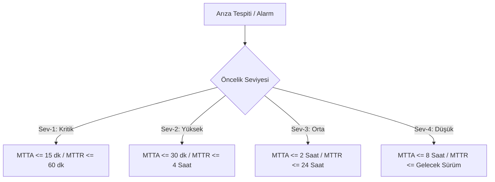

# EK-A: HİZMET SEVİYESİ TAAHHÜDÜ VE HEDEFLERİ ŞARTNAMESİ (SLA & SLO)

**Sözleşme Referans No:** AB-NX-2026-SLA-001  
**Bağlı Olduğu Ana Sözleşme:** AB-NX-2026-MSA-001  
**Yürürlük Tarihi:** 01 Kasım 2026  

İşbu Hizmet Seviyesi Taahhüdü ve Hedefleri Şartnamesi ("**SLA**"), Ana Sözleşme'nin ayrılmaz bir parçası olup, Tedarikçi tarafından Atlas Bank T.A.Ş.'ye sunulacak olan FinGuard AI SaaS Platformu'nun teknik performans, erişilebilirlik, arıza müdahale ve servis kredisi kurallarını düzenler.

---

## 1. KAVRAMSAL ÇERÇEVE: SLI, SLO VE SLA AYRIMI

* **SLI (Service Level Indicator - Hizmet Seviyesi Göstergesi):** Sistemin anlık veya periyodik performansını ölçen somut metriklerdir (Örn: Başarılı istek yüzdesi, p99 gecikme süresi).
* **SLO (Service Level Objective - Hizmet Seviyesi Hedefi):** Mühendislik ve operasyon ekiplerinin sistemin sağlıklı çalışması için tutturmayı hedeflediği içsel teknik eşik değeridir (Örn: Aylık API başarı oranı >= %99.99).
* **SLA (Service Level Agreement - Hizmet Seviyesi Taahhüdü):** Banka'ya yasal ve mali olarak taahhüt edilen, ihlali durumunda cezai şart ve servis kredisi doğuran asgari operasyonel sınırları ifade eder (Örn: Uptime >= %99.95).

---

## 2. ERİŞİLEBİLİRLİK TAAHHÜDÜ (UPTIME SLA)

### 2.1. Asgari Uptime Oranı
Tedarikçi, FinGuard AI Platformu'nun üretim (Production) ortamının ve kritik API uç noktalarının her takvim ayında **en az %99.95** oranında kesintisiz olarak erişilebilir olacağını taahhüt eder.

### 2.2. Uptime Hesaplama Formülü
Aylık Çalışma Süresi Yüzdesi aşağıdaki formüle göre hesaplanır:

$$\text{Erişilebilirlik (\%)} = \left( \frac{\text{Toplam Aylık Dakika} - \text{İstisnai Süre} - \text{Plansız Kesinti Süresi}}{\text{Toplam Aylık Dakika} - \text{İstisnai Süre}} \right) \times 100$$

* *Toplam Aylık Dakika:* İlgili takvim ayındaki toplam dakika sayısı (Örn: 30 günlük ay için 43.200 dakika).
* *İstisnai Süre:* Usulüne uygun onaylanmış Planlı Bakım Pencereleri ve Banka kaynaklı teyitli ağ kesintileri.
* *Plansız Kesinti Süresi:* Sistemin sorgulara HTTP 5xx yanıtı vermesi, API yanıtının 3.000 ms üzerinde sürmesi veya tamamen ulaşılamaz olduğu toplam dakika süresi.

### 2.3. Planlı Bakım Pencereleri (Planned Maintenance)
1. Bakım çalışmaları yalnızca Pazar günleri **02:00 - 05:00 (TSİ)** saatleri arasında gerçekleştirilebilir.
2. Bakım bildirimi Banka Operasyon Merkezi'ne (NOC) en az **7 (yedi) takvim günü** öncesinden yazılı/elektronik olarak iletilmelidir.
3. Acil güvenlik yamaları haricinde aylık toplam planlı bakım süresi **180 dakikayı** aşamaz.

---

## 3. TEKNİK PERFORMANS HEDEFLERİ (SLO / SLI MATRİSİ)

Tedarikçi sistemlerinin sağlaması gereken teknik metrikler ve hata bütçesi (Error Budget) eşikleri aşağıda tanımlanmıştır:

| Metrik Türü | Hizmet Seviyesi Göstergesi (SLI) | Dahili Mühendislik Hedefi (SLO) | Asgari Yasal Taahhüt (SLA) | Ölçüm Periyodu |
| :--- | :--- | :--- | :--- | :--- |
| **Erişilebilirlik** | Başarılı HTTP (2xx/3xx/4xx) istek oranı | **%99.99** Uptime | **%99.95** Uptime | Aylık Kümülatif |
| **API Gecikmesi (p95)** | Banka Gateway - FinGuard arası uçtan uca süre | $\le$ 60 ms | $\le$ 100 ms | 5 Dakikalık Pencereler |
| **API Gecikmesi (p99)** | Kuyruk ve yapay zekâ model çıkarım süresi | $\le$ 120 ms | $\le$ 200 ms | 5 Dakikalık Pencereler |
| **Hata Oranı (5xx)** | Platform kaynaklı HTTP 500, 502, 503 oranı | $\le$ %0.01 | $\le$ %0.05 | Aylık Toplam İstek |
| **Kapasite (Throughput)**| Eşzamanlı işleme kapasitesi | 8.000 TPS | 5.000 TPS Garanti | Anlık Pik Testi |
| **Veri Güncelliği** | ML Modeli Özellik (Feature Store) senkronizasyonu | $\le$ 500 ms | $\le$ 2.000 ms | Sürekli |

### 3.4. Hata Bütçesi (Error Budget) Politikası
Aylık %99.95 taahhüdü kapsamında izin verilen azami plansız kesinti süresi **21.6 dakika/ay**'dır. Bir ay içerisinde hata bütçesinin %75'i tüketildiğinde:
* Tedarikçi tüm yeni özellik sürümlerini (Feature Deployments) dondurur (Freeze).
* Tüm mühendislik kapasitesi sistem kararlılığı ve altyapı iyileştirmelerine yönlendirilir.

---

## 4. ARIZA YÖNETİMİ, MÜDAHALE VE ÇÖZÜM SÜRELERİ

Arızalar ciddiyet seviyelerine göre sınıflandırılır. Süreler Banka'nın arıza kaydı açması veya Tedarikçi izleme sistemlerinin alarm üretmesiyle başlar.

### 4.1. Öncelik Seviyesi Matrisi

| Seviye | Tanım ve Etki Kapsamı | Çalışma Esası | Hedef İlk Yanıt (MTTA) | Hedef Çözüm / Zafer (MTTR) | Kök Neden Analizi (RCA) |
| :--- | :--- | :--- | :--- | :--- | :--- |
| **Severity 1 (Kritik)** | Üretim ortamı tamamen durmuş, gerçek zamanlı fraud veya kredi skorlama yapılamıyor, temel bankacılık işlemleri tıkanmış. | 7/24/365 Kesintisiz | **$\le$ 15 Dakika** | **$\le$ 1 Saat** (Geçici veya Kalıcı Çözüm) | 24 Saat içinde detaylı RCA raporu |
| **Severity 2 (Yüksek)** | Platformun ana fonksiyonları çalışıyor ancak yedeklilik (redundancy) kaybolmuş, gecikme p99 > 500ms olmuş veya belirli bir modül (örn: Toplu Raporlama) çökmüş. | 7/24/365 | **$\le$ 30 Dakika** | **$\le$ 4 Saat** | 48 Saat içinde RCA raporu |
| **Severity 3 (Orta)** | Sistemin temel işleyişini aksatmayan, ikame çalışma yöntemi (workaround) bulunan münferit fonksiyonel arızalar. | Mesai Saatleri (08:00-18:00) | **$\le$ 2 Saat** | **$\le$ 24 Saat** | Talep halinde |
| **Severity 4 (Düşük)** | Kozmetik kullanıcı arayüzü hataları, dokümantasyon eksiklikleri veya iyileştirme talepleri. | Mesai Saatleri | **$\le$ 8 Saat** | İlk planlı sürüm paketinde |

* **MTTA (Mean Time to Acknowledge):** Çağrının yetkili mühendis tarafından alınıp teşhise başlandığının bildirilmesi.
* **MTTR (Mean Time to Resolve/Restore):** Sistemin normal çalışır duruma getirilmesi veya kabul edilebilir bir geçici çözüm (workaround) sağlanması.

---

## 5. SERVİS KREDİSİ VE CEZAİ ŞART MEKANİZMASI

Tedarikçi'nin aylık taahhüt edilen Uptime oranını tutturamaması halinde Banka, bir sonraki ayın faturasından aşağıdaki oranlarda **Servis Kredisi (Ceza İndirimi)** mahsup etme hakkına sahiptir:

| Aylık Gerçekleşen Uptime Oranı | Faturadan Mahsup Edilecek Servis Kredisi | Banka'nın Ek Hakları |
| :--- | :--- | :--- |
| **%99.95 ve üzeri** | %0 (Tam Hizmet İfası) | Yok |
| **%99.90 — %99.94** | İlgili ayın sabit lisans bedelinin **%15'i** | Düzeltici Eylem Planı (CAP) sunma zorunluluğu |
| **%99.50 — %99.89** | İlgili ayın sabit lisans bedelinin **%30'u** | Üst yönetim seviyesinde kriz toplantısı |
| **%99.00 — %99.49** | İlgili ayın sabit lisans bedelinin **%50'si** | Bağımsız denetim talep hakkı |
| **%99.00'ın altı** | İlgili ayın sabit lisans bedelinin **%100'ü (Fatura İptali)** | **Banka'nın tazminatlı ve derhal haklı fesih hakkı** |

### 5.2. Severity-1 Çözüm Süresi İhlal Cezası
Uptime oranından bağımsız olarak, bir takvim ayı içerisinde meydana gelen herhangi bir Severity-1 arızasının çözümünün (MTTR) **2 saati aşması** durumunda, aşan her saat için aylık sözleşme bedelinin **%5'i** oranında ek cezai şart uygulanır (Maksimum aylık tavan: Aylık faturanın %50'si).

---

## 6. TELEMETRİ, ŞEFFAFLIK VE DENETİM

1. **Canlı İzleme Portalı:** Tedarikçi, Banka Güvenlik ve Ağ Operasyon Merkezi (SOC/NOC) ekiplerine sistemin uptime durumunu, API gecikmelerini ve hata oranlarını anlık gösteren izleme paneline (read-only) 7/24 erişim sağlar.
2. **Aylık SLA Raporu:** Tedarikçi her ayın 1. iş gününde geçmiş aya ait sistem metriklerini, arıza kayıtlarını, MTTA/MTTR sürelerini içeren imzalı SLA İfa Raporunu Banka'ya sunar.
3. **Kök Neden Analizi (RCA):** Tüm Sev-1 ve Sev-2 olaylarında; olayın kronolojisi, tetikleyici neden, kalıcı düzeltici faaliyetler ve hata önleme tedbirlerini içeren standart "5 Neden (5-Why)" formatında hazırlanmış RCA dokümanı zorunludur.

---

| **ATLAS BANK T.A.Ş.** | **NEXATECH FİNANSAL YAZILIM A.Ş.** |
| :--- | :--- |
| **İmza:** ___________________________ | **İmza:** ___________________________ |
| **İsim:** Mehmet Yılmaz / CIO | **İsim:** Caner Özkan / CEO |
| **Tarih:** 01.11.2026 | **Tarih:** 01.11.2026 |
