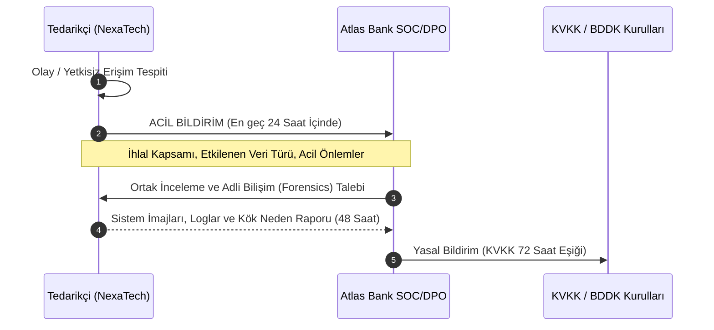

# EK-C: VERİ İŞLEME SÖZLEŞMESİ (DPA), BANKACILIK SIRRI VE KVKK UYUM TAAHHÜTNAMESİ

**Sözleşme Referans No:** AB-NX-2026-DPA-001  
**Bağlı Olduğu Ana Sözleşme:** AB-NX-2026-MSA-001  
**Yürürlük Tarihi:** 01 Kasım 2026  

İşbu Veri İşleme Sözleşmesi ("**DPA**"), Atlas Bank T.A.Ş. ("**Banka**" veya "**Veri Sorumlusu**") ile NexaTech Finansal Yazılım A.Ş. ("**Tedarikçi**" veya "**Veri İşleyen**") arasında, Ana Sözleşme kapsamında gerçekleştirilecek kişisel veri işleme faaliyetlerinin ve Bankacılık Sırrı kapsamındaki bilgilerin korunması amacıyla akdedilmiştir.

---

## 1. YASAL ÇERÇEVE VE ROLLER

1.1. **Roller:** İşbu Sözleşme tahtında Banka **Veri Sorumlusu (Data Controller)**, Tedarikçi ise münhasıran Banka adına hareket eden **Veri İşleyen (Data Processor)** sıfatını haizdir.  
1.2. **Mevzuat Dayanağı:** İşbu Sözleşme; 6698 sayılı Kişisel Verilerin Korunması Kanunu ("**KVKK**"), 5411 sayılı Bankacılık Kanunu'nun 73. maddesi ("**Bankacılık Sırrı**"), BDDK Bankaların Bilgi Sistemleri ve Destek Hizmetleri Hakkında Yönetmelik ve Avrupa Birliği Genel Veri Koruma Tüzüğü ("**GDPR**") hükümlerine tam uyumlu olarak tanzim edilmiştir.

---

## 2. BANKACILIK SIRRI VE VERİ EGEMENLİĞİ (DATA RESIDENCY)

2.1. **Sır Saklama Yükümlülüğü:** Tedarikçi ve personeli; Banka'ya, Banka müşterilerine, finansal işlemlere ve hesap hareketlerine ilişkin edindikleri her türlü bilginin 5411 sayılı Kanun m. 73 kapsamında **Müşteri Sırrı ve Bankacılık Sırrı** olduğunu, bu bilgileri süresiz olarak gizli tutmakla yükümlü olduklarını kabul, beyan ve taahhüt eder. Bu yükümlülük Sözleşme sona erse dahi süresiz olarak devam eder.  
2.2. **Sınır Ötesi Aktarım Yasağı (Strict Data Localization):**  
a) Banka Verileri, müşteri işlem kayıtları, loglar ve bu verilerin yedekleri **münhasıran Türkiye Cumhuriyeti sınırları içerisinde** barındırılacak ve işlenecektir.  
b) Tedarikçi; Banka'nın açık yazılı izni ve BDDK'nın istisnai uygunluk görüşü olmaksızın, verileri hiçbir şekilde yurt dışına aktaramaz, yurt dışı merkezli genel bulut (Public Cloud) servislerine kopyalayamaz veya yurt dışından uzaktan erişime açamaz.

---

## 3. VERİ İŞLEME PRENSİPLERİ VE TALİMATLARA UYGUNLUK

3.1. **Talimata Bağlılık:** Tedarikçi, Banka Verilerini yalnızca Banka'nın yazılı talimatları doğrultusunda ve Ana Sözleşme'deki FinGuard AI SaaS hizmetlerinin ifası amacıyla sınırlı olarak işleyebilir.  
3.2. **Veri Minimizasyonu ve Maskeleme:**  
* Hassas ödeme verileri (Kredi kartı numarası - PAN, CVV vb.) hiçbir surette açık metin (cleartext) olarak saklanamaz; PCI-DSS standartlarında tokenize edilecek veya ilk 6 - son 4 hane haricinde maskelenecektir.  
* T.C. Kimlik Numarası (TCKN), ad-soyad gibi kimlik belirleyici veriler Platform veritabanında tek yönlü kriptografik özetleme (Hashing - SHA-256 with Salt) veya asimetrik şifreleme yöntemleriyle tutulacaktır.  
3.3. **Yapay Zekâ ve Model Eğitimi Kısıtlaması:** Tedarikçi, Banka'nın verilerini kendi genel yapay zekâ modellerini eğitmek, geliştirmek veya diğer müşterilerinin hizmetine sunmak amacıyla **kesinlikle kullanamaz**. Banka verisiyle fine-tune edilen veya eğitilen tüm modeller münhasıran Banka'ya aittir.

---

## 4. ALT VERİ İŞLEYEN (SUB-PROCESSOR) KULLANIMI

4.1. Tedarikçi, Banka Verilerinin işlenmesini doğrudan veya dolaylı olarak Banka'nın **önceden alınmış yazılı onayı olmaksızın** hiçbir üçüncü kişi alt yükleniciye (Sub-processor) devredemez.  
4.2. Banka tarafından onaylanan alt veri işleyenler, işbu Sözleşme'de Tedarikçi'ye yüklenen yükümlülüklerden daha hafif olmayan yazılı sözleşmelerle bağlanmak zorundadır. Tedarikçi, alt veri işleyenlerin eylemlerinden ve ihlallerinden Banka'ya karşı müştereken ve müteselsilen sorumludur.

---

## 5. VERİ İHLALİ VE GÜVENLİK OLAYI BİLDİRİMİ (BREACH NOTIFICATION)

5.1. **Bildirim Süresi:** Tedarikçi, Banka Verilerine yetkisiz erişim, verilerin sızdırılması, kaybolması, imha edilmesi veya herhangi bir siber güvenlik olayı şüphesi doğması halinde durumu derhal ve en geç **24 (yirmi dört) saat** içinde Banka Bilgi Güvenliği ve Uyum ekiplerine yazılı olarak bildirmekle yükümlüdür.  
5.2. **Bildirimin İçeriği:** İhlal bildirimi asgari olarak; olayın niteliğini, etkilenen yaklaşık kişi ve veri kaydı sayısını, verilerin kategorisini, muhtemel sonuçlarını ve alınan/alınması önerilen telafi edici tedbirleri içermelidir.  
5.3. **Adli Bilişim ve İnceleme:** Tedarikçi, Banka'nın görevlendireceği bağımsız adli bilişim (forensics) uzmanlarına sistem loglarını ve inceleme olanaklarını eksiksiz sağlamak zorundadır.

---

## 6. İLGİLİ KİŞİ HAKLARININ DESTEKLENMESİ

KVKK'nın 11. maddesi ve GDPR Chapter III kapsamındaki ilgili kişi (Data Subject) başvurularında (bilgi alma, düzeltme, silme, işlemeyi durdurma); Tedarikçi, Banka'nın talebini tebliğ aldığı tarihten itibaren en geç **3 (üç) iş günü** içinde gerekli teknik aksiyonları almak ve sistemden verileri silmek/anonimleştirmekle yükümlüdür.

---

## 7. VERİLERİN İADESİ VE İMHASI PROTOKOLÜ

7.1. **İade Yükümlülüğü:** Ana Sözleşme'nin herhangi bir nedenle sona ermesi halinde Tedarikçi, Banka'nın tercihine göre tüm Banka Verilerini, logları ve analitik çıktıları güvenli bir formatta (JSON/Parquet/SQL Dump) şifreli olarak Banka'ya **15 (on beş) takvim günü** içinde teslim eder.  
7.2. **Güvenli İmha:** Verilerin eksiksiz devrinin ardından Tedarikçi, sistemlerinde ve yedeklerinde kalan tüm verileri **NIST SP 800-88 Rev.1 (Guidelines for Media Sanitization)** standardına uygun olarak geri döndürülemez şekilde siler veya imha eder.  
7.3. **İmha Tutanağı:** İmha işleminin tamamlanmasını müteakip 7 (yedi) gün içinde Tedarikçi yetkilileri tarafından imzalanmış "Resmi Veri İmha Tutanağı (Certificate of Sanitization)" Banka'ya teslim edilir.

---

## 8. TAZMİNAT VE CEZAİ SORUMLULUK

İşbu Sözleşme'nin, Bankacılık Sırrı hükümlerinin veya KVKK düzenlemelerinin Tedarikçi veya çalışanları tarafından ihlali neticesinde; Banka'ya veya Banka müşterilerine verilecek tüm doğrudan zararlardan, KVKK ve BDDK tarafından Banka'ya kesilecek her türlü idari para cezasından Tedarikçi **sınırsız olarak ve rücuen** sorumludur. Ana Sözleşme'deki hiçbir sorumluluk sınırlaması (Limitation of Liability) veri güvenliği ve sır saklama ihlallerinde uygulanamaz.

---

| **ATLAS BANK T.A.Ş.** (Veri Sorumlusu) | **NEXATECH FİNANSAL YAZILIM A.Ş.** (Veri İşleyen) |
| :--- | :--- |
| **İmza:** ___________________________ | **İmza:** ___________________________ |
| **İsim:** Av. Zeynep Kaya / CCO & DPO | **İsim:** Av. Murat Erdem / Legal Counsel |
| **Tarih:** 01.11.2026 | **Tarih:** 01.11.2026 |
