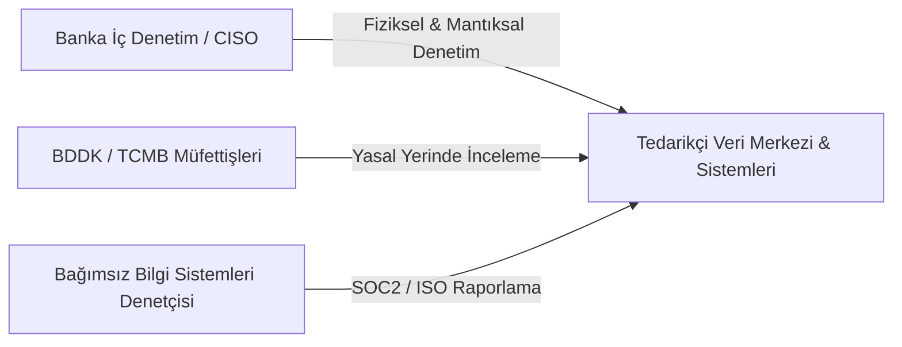

# EK-D: BİLGİ GÜVENLİĞİ, SİBER DAYANIKLILIK VE DENETİM ŞARTNAMESİ

**Sözleşme Referans No:** AB-NX-2026-SEC-001  
**Bağlı Olduğu Ana Sözleşme:** AB-NX-2026-MSA-001  
**Yürürlük Tarihi:** 01 Kasım 2026  

İşbu Bilgi Güvenliği, Siber Dayanıklılık ve Denetim Şartnamesi ("**Şartname**"), Atlas Bank T.A.Ş. ("**Banka**") bilgi varlıklarının, müşteri verilerinin ve FinGuard AI SaaS Platformu'nun siber tehditlere karşı korunması amacıyla uyulması zorunlu asgari güvenlik tedbirlerini ve denetim kurallarını belirler.

---

## 1. ZORUNLU SERTİFİKASYONLAR VE STANDARTLAR

Tedarikçi, Sözleşme süresi boyunca aşağıdaki standart ve sertifikasyonlara sahip olduğunu belgelemek ve her yıl güncel denetim raporlarını Banka'ya ibraz etmekle yükümlüdür:
1. **ISO/IEC 27001:2022** (Bilgi Güvenliği Yönetim Sistemi)
2. **ISO/IEC 27017** (Bulut Hizmetlerinde Bilgi Güvenliği) & **ISO/IEC 27018** (Bulutta Kişisel Verilerin Korunması)
3. **SOC 2 Type II Denetim Raporu** (Güvenlik, Erişilebilirlik ve Gizlilik güvenilirlik ilkelerini kapsayan, bağımsız denetim kuruluşu onaylı yıllık rapor)
4. **PCI-DSS v4.0** (Seviye 1 Hizmet Sağlayıcı Uygunluk Sertifikası - RoC/AoC)
5. **BDDK Bilgi Sistemleri Uyum Raporu** (Destek Hizmeti Sağlayıcıları denetim kriterleri)

---

## 2. KİMLİK, ERİŞİM VE AYRICALIKLI HESAP YÖNETİMİ (IAM / PAM)

2.1. **Sıfır Güven (Zero Trust) Mimarisi:** Platform altyapısına erişimler Sıfır Güven prensiplerine göre yapılandırılacaktır. Hiçbir kullanıcı veya servis, ağ konumu nedeniyle güvenilir kabul edilmez.  
2.2. **Çok Faktörlü Kimlik Doğrulama (MFA):** Tedarikçi'nin üretim (Production) ortamına erişen tüm idari personeli için donanım tabanlı (FIDO2 / U2F) veya zaman tabanlı (TOTP) MFA kullanımı zorunludur. SMS bazlı doğrulama kabul edilmez.  
2.3. **Üretim Ortamında Doğrudan Veri Erişimi Yasağı (Zero Standing Access):**  
* Tedarikçi personeli, Banka'nın canlı verilerine varsayılan olarak erişemez.  
* İstisnai acil arıza müdahalelerinde; Banka CISO onayına tabi **"İki Adam Kuralı (Four-Eyes Principle)"**, süre kısıtlı (en fazla 2 saatlik) **Ayrıcalıklı Erişim Yönetimi (PAM - Break-Glass)** oturumu açılacaktır.  
* Bu oturum boyunca gerçekleştirilen tüm tuş vuruşları (keystroke) ve ekran hareketleri video ve metin formatında kaydedilerek Banka'ya raporlanacaktır.

---

## 3. GÜVENLİ YAZILIM GELİŞTİRME (SSDLC) VE ZAFİYET YÖNETİMİ

3.1. **CI/CD Güvenlik Hattı (DevSecOps):**  
Platform'un her yeni sürüm derlemesinde aşağıdaki testler otomatik olarak çalıştırılacaktır:
* **SAST (Statik Güvenlik Testi):** Kod analizinde OWASP Top 10 ve SANS CWE-25 açıkları taranacaktır.
* **SCA (Yazılım Tedarik Zinciri Güvenliği):** Açık kaynaklı kütüphanelerdeki zafiyetler ve SBOM (Software Bill of Materials) listesi doğrulanacaktır.
* **DAST (Dinamik Güvenlik Testi):** API uç noktaları otomatik saldırı simülasyonları ile taranacaktır.

3.2. **Zafiyet Kapatma Süreleri (Vulnerability Remediation SLA):**

| Risk Seviyesi | CVSS v3.1 Taban Skoru | Azami Kapatma / Yama Süresi | Geçici Önlem (Workaround) Süresi |
| :--- | :--- | :--- | :--- |
| **Kritik (Critical)** | 9.0 — 10.0 | **$\le$ 48 Saat** | $\le$ 12 Saat (WAF kuralı vb.) |
| **Yüksek (High)** | 7.0 — 8.9 | **$\le$ 7 Takvim Günü** | $\le$ 24 Saat |
| **Orta (Medium)** | 4.0 — 6.9 | **$\le$ 30 Takvim Günü** | Planlı sürümde |
| **Düşük (Low)** | 0.1 — 3.9 | **$\le$ 90 Takvim Günü** | Planlı sürümde |

---

## 4. SIZMA TESTLERİ (PENETRATION TESTING) VE SİBER SAVUNMA

4.1. **Tedarikçi Sızma Testleri:** Tedarikçi, yılda en az **2 (iki) kez** TSE A Seviye veya CREST akreditasyonuna sahip bağımsız bir kuruluşa Platform üzerinde "Gri Kutu (Grey Box)" sızma testi yaptırmak ve raporun yönetici özetini Banka'ya teslim etmek zorundadır.  
4.2. **Banka'nın Doğrudan Sızma Testi Hakkı:** Banka, önceden 5 (beş) iş günü öncesinden bildirmek kaydıyla, kendi iç siber güvenlik uzmanları veya yetkilendirdiği test firmaları vasıtasıyla Platform'a yılda en az bir kez doğrudan sızma testi, stres testi ve API güvenlik analizi yapma hakkına sahiptir.  
4.3. **DDoS Koruması:** Tedarikçi, en az 100 Gbps seviyesindeki Dağıtık Hizmet Engelleme (DDoS) saldırılarını Banka trafiğini kesintiye uğratmadan bertaraf edebilecek seviyede bulut tabanlı bir scrubbing/koruma kalkanı bulundurmak zorundadır.

---

## 5. GÜVENLİK GÜNLÜK KAYITLARI (LOGGING) VE SIEM ENTEGRASYONU

5.1. **Log Kapsamı:** Sistem bileşenlerine yapılan tüm başarılı ve başarısız giriş denemeleri, yetki değişiklikleri, API çağrıları, şüpheli işlem tetiklemeleri ve idari komutlar detaylı olarak loglanacaktır.  
5.2. **Değiştirilemezlik (WORM Depolama):** Log kayıtları, olası siber saldırganların izlerini silmesini önlemek amacıyla kriptografik hash zincirleri (örneğin SHA-256) ile kilitlenmiş değiştirilemez (Write Once, Read Many) depolama alanında en az **10 (on) yıl** süreyle saklanacaktır.  
5.3. **Banka SIEM Entegrasyonu:** Tedarikçi, Banka'nın talep etmesi halinde tüm güvenlik ve erişim loglarını güvenli syslog (TLS over RFC 5424) veya Kafka topic'leri üzerinden Banka'nın Güvenlik Operasyon Merkezi (Banka SOC) sistemine gerçek zamanlı olarak iletecektir.

---

## 6. DENETİM HAKLARI (RIGHT TO AUDIT) VE YERİNDE İNCELEME

6.1. **Yasal Denetim Yetkisi:** 5411 sayılı Bankacılık Kanunu gereği; BDDK müfettişleri, TCMB yetkilileri ve Banka denetçileri; Tedarikçi'nin veri merkezlerini, ofislerini, çağrı kayıtlarını, kaynak kodlarını ve log altyapısını önceden izin almaksızın fiziken ve mantıken denetleme, kopyalama ve inceleme hakkına sahiptir.  
6.2. **İşbirliği Zorunluluğu:** Tedarikçi, bu denetimlerde görev alacak uzmanlara her türlü teknik kolaylığı, yönetici erişimlerini ve gerekli çalışma ortamını gecikmeksizin sağlamakla yükümlüdür.

---

| **ATLAS BANK T.A.Ş.** | **NEXATECH FİNANSAL YAZILIM A.Ş.** |
| :--- | :--- |
| **İmza:** ___________________________ | **İmza:** ___________________________ |
| **İsim:** Hakan Şen / CISO | **İsim:** Serdar Aydın / Head of Security |
| **Tarih:** 01.11.2026 | **Tarih:** 01.11.2026 |
