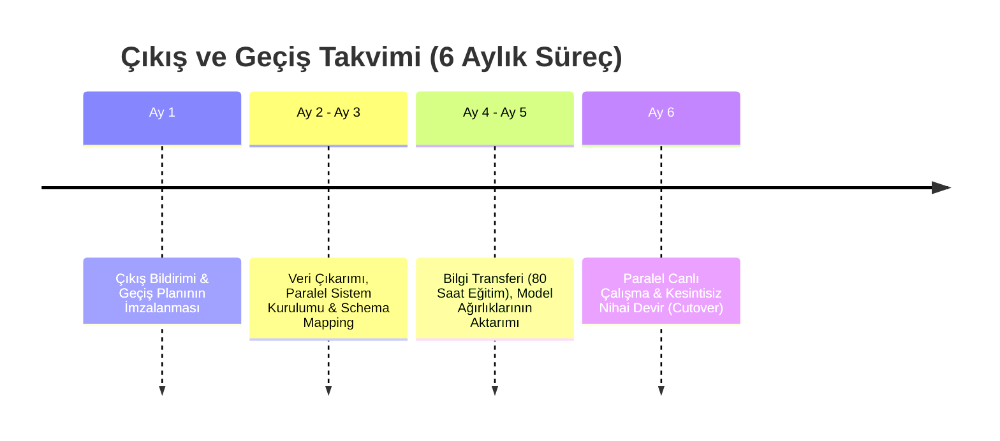

# EK-E: İŞ SÜREKLİLİĞİ, FELAKETTEN KURTARMA, KAYNAK KOD YEDİEMİNİ (ESCROW) VE ÇIKIŞ STRATEJİSİ

**Sözleşme Referans No:** AB-NX-2026-BCP-001  
**Bağlı Olduğu Ana Sözleşme:** AB-NX-2026-MSA-001  
**Yürürlük Tarihi:** 01 Kasım 2026  

İşbu Şartname, Atlas Bank T.A.Ş. ("**Banka**") ve NexaTech Finansal Yazılım A.Ş. ("**Tedarikçi**") arasında; olağanüstü durumlarda FinGuard AI SaaS Platformu'nun kesintisiz hizmet vermesi, kaynak kodların güvence altına alınması ve sözleşme bitiminde operasyonel geçişin sorunsuz tamamlanmasını düzenlemek amacıyla akdedilmiştir.

---

## 1. İŞ SÜREKLİLİĞİ VE FELAKETTEN KURTARMA (BCP / DR)

Tedarikçi, ISO 22301 İş Sürekliliği Yönetim Sistemi standartlarına ve BDDK mevzuatına uygun bir İş Sürekliliği ve Felaketten Kurtarma Planı tesis etmekle yükümlüdür.

```
       BİRİNCİL VERİ MERKEZİ (İSTANBUL)               FELAKET KURTARMA MERKEZİ (ANKARA)
+---------------------------------------------+     +---------------------------------------------+
|  FinGuard AI Üretim Kümesi (Active)         |     |  FinGuard AI Sıcak Yedek Küme (Hot-Standby) |
|  - Kubernetes Workloads                     |     |  - Kubernetes Replicas                      |
|  - PostgreSQL Primary (Read/Write)          |==+  |  - PostgreSQL Standby (Async Replica)       |
|  - Kafka Cluster Primary                    |  |  |  - Kafka MirrorMaker 2 Replica              |
+---------------------------------------------+  |  +---------------------------------------------+
                                                 |
                                     Sürekli Replikasyon
                                    (Ağ Gecikmesi < 15ms)
                                                 |
                                                 v
                                 RPO <= 15 Dk  /  RTO <= 60 Dk
```

### 1.1. RPO ve RTO Eşik Değerleri

| Parametre | Tanım | Taahhüt Edilen Asgari Değer |
| :--- | :--- | :--- |
| **RPO (Recovery Point Objective)** | Felaket anında kabul edilebilir azami veri kaybı süresi | **$\le$ 15 Dakika** |
| **RTO (Recovery Time Objective)** | Felaket anından itibaren ikincil merkezde sistemin tam ayağa kalkma süresi | **$\le$ 60 Dakika** |
| **Coğrafi Mesafe** | Birincil ve İkincil Veri Merkezleri arasındaki asgari coğrafi uzaklık | **En az 250 Kilometre** (İstanbul - Ankara) |

### 1.2. Yıllık Felaket Tatbikatı (DR Drill)
1. Tedarikçi, her takvim yılında en az **1 (bir) kez**, tarihi Banka ile en az 30 gün önceden kararlaştırılacak şekilde fiili Felaketten Kurtarma Tatbikatı icra edecektir.
2. Tatbikat sırasında canlı trafik, birincil veri merkezinden ikincil felaket kurtarma merkezine kontrollü olarak aktarılacak, RTO ve RPO değerleri Banka mühendisleri tarafından canlı olarak test edilecek ve ortak "DR Tatbikat Başarı Raporu" düzenlenecektir.

---

## 2. KAYNAK KOD YEDİEMİN ANLAŞMASI (SOFTWARE ESCROW AGREEMENT)

Banka'nın operasyonel sürekliliğini teminat altına almak amacıyla Tedarikçi, bağımsız bir **Yediemin Kuruluşu (Escrow Agent)** ile üç taraflı bir Yazılım Yediemin Sözleşmesi akdedecektir.

### 2.1. Yediemine Depolanacak Varlıklar (Escrow Deposit)
Tedarikçi her 3 (üç) ayda bir veya her ana sürüm güncellemesinde (Major Release) aşağıdaki materyalleri şifreli olarak Yediemin kasasına yatırmakla yükümlüdür:
1. FinGuard AI Platformu'nun tüm kaynak kodları (Frontend, Backend, Microservices).
2. Makine öğrenmesi modelleri mimari kodları, model ağırlıkları (Weights) ve hiperparametre konfigürasyonları.
3. Altyapı Kodları (IaC - Terraform, Helm Chart, Ansible scriptleri, Dockerfile'lar).
4. Sistemi sıfırdan derlemek, yapılandırmak ve canlıya almak için gerekli "Derleme ve Kurulum Kılavuzları (Build & Deployment Runbooks)".

### 2.2. Kodların Serbest Bırakılma Koşulları (Release Triggers)
Aşağıdaki hallerden herhangi birinin gerçekleşmesi durumunda Yediemin Kuruluşu, Banka'nın tek taraflı yazılı talebi üzerine depolanan kaynak kodları ve kurulum paketlerini **en geç 5 (beş) iş günü içinde** Banka'ya teslim edecektir:
1. **İflas veya Tasfiye:** Tedarikçi'nin iflas etmesi, konkordato ilan etmesi, kayyum atanması veya tasfiyeye girmesi.
2. **Hizmetin Haksız Durdurulması:** Tedarikçi'nin Sözleşme'de kararlaştırılan bakım, onarım veya lisans hizmetlerini haklı bir neden olmaksızın durdurması ve Banka'nın yazılı ihtarına rağmen 14 (on dört) gün içinde hizmeti yeniden başlatmaması.
3. **Şirket Kontrol Değişikliği (Change of Control):** Tedarikçi'nin mülkiyetinin veya çoğunluk hisselerinin Banka ile doğrudan ticari rekabet içinde olan bir finansal kuruluş veya rakip teknoloji şirketi tarafından devralınması ve Banka'nın iş ortaklığına devam etmek istememesi.
4. **Esaslı Sözleşme İhlali:** Tedarikçi'nin SLA taahhütlerini bir yıl içinde 3 defadan fazla kritik (%99.00 altı) seviyede ihlal etmesi ve durumun düzeltilememesi.

### 2.3. Kullanım Lisansı (Escrow Release License)
Kaynak kodların Banka'ya teslim edilmesi halinde Banka; kodları yalnızca kendi bünyesinde ve iştiraklerinde sistemi çalıştırmak, güncellemek, hata ayıklamak ve idame ettirmek amacıyla münhasır olmayan, telifsiz (royalty-free), daimi bir iç kullanım hakkına sahip olacaktır.

---

## 3. ÇIKIŞ STRATEJİSİ VE GEÇİŞ DESTEĞİ (EXIT STRATEGY)

Sözleşme'nin süresinin dolması, feshedilmesi veya yenilenmemesi durumlarında Banka bankacılık operasyonlarının kesintiye uğramaması esastır.



### 3.1. Geçiş Dönemi Hizmetleri (Transition Assistance Period)
Sözleşme'nin feshini veya sona ermesini müteakip en az **6 (altı) ay süreyle** Tedarikçi:
1. FinGuard AI SaaS hizmetini mevcut SLA ve performans standartlarında kesintisiz olarak sunmaya devam edecektir.
2. Banka'nın göstereceği yeni tedarikçiye veya Banka'nın kendi bilgi işlem merkezine sistemin ve verilerin taşınması için gerekli API uç noktalarını ve veri aktarım boru hatlarını (ETL Pipelines) tahsis edecektir.
3. Banka teknik personeline en az **80 (seksen) adam-saat** teknik mimari eğitimi ve bilgi transferi (Knowledge Transfer) sağlayacaktır.

### 3.2. Veri Çıkarımı ve Biçimlendirme
Tüm geçmiş müşteri işlem skorları, model eğitim veri setleri ve loglar; ilişkisel bütünlüğü korunmuş açık standart formatlarda (Apache Parquet, JSON ve PostgreSQL DDL dump) Banka'ya şifreli transfer protokolleriyle teslim edilecektir.

---

| **ATLAS BANK T.A.Ş.** | **NEXATECH FİNANSAL YAZILIM A.Ş.** |
| :--- | :--- |
| **İmza:** ___________________________ | **İmza:** ___________________________ |
| **İsim:** Mehmet Yılmaz / CIO | **İsim:** Caner Özkan / CEO |
| **Tarih:** 01.11.2026 | **Tarih:** 01.11.2026 |
